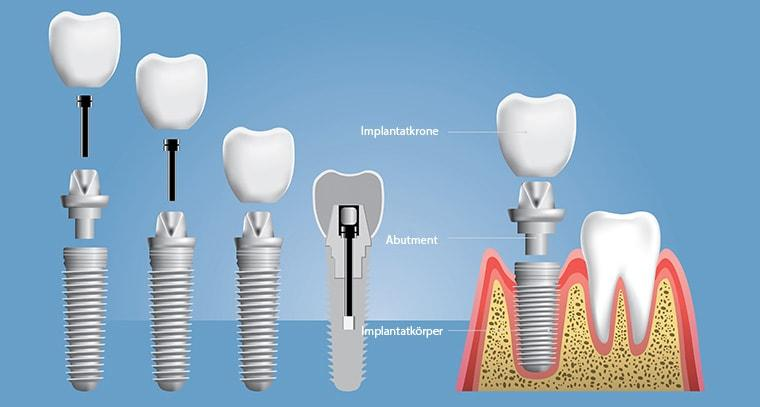
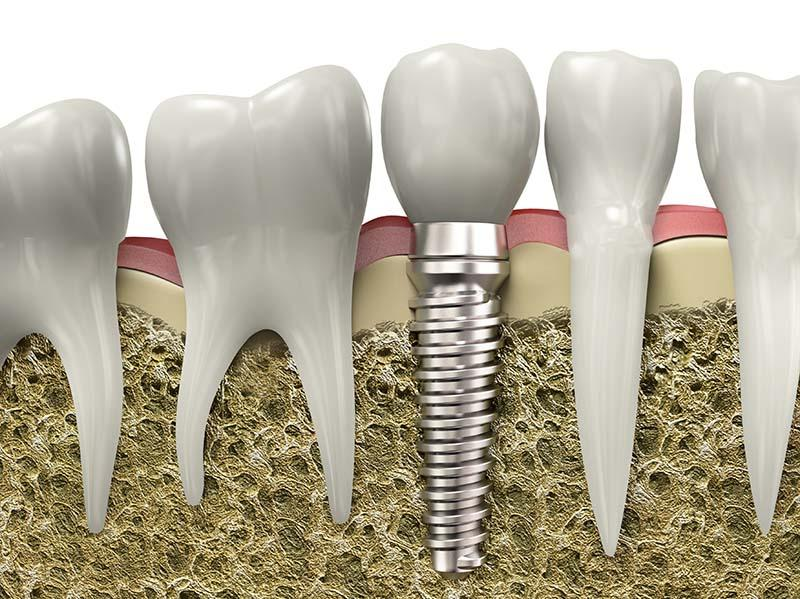
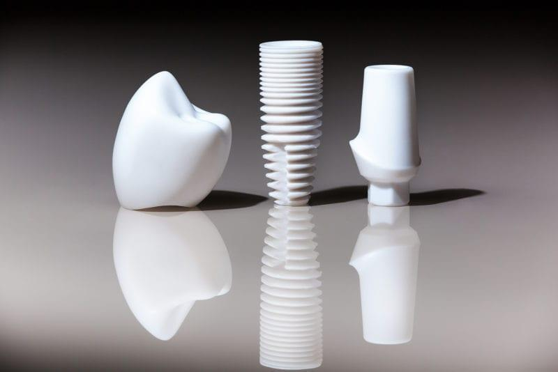

If you deal with the subject of dentures, sooner or later you will stumble across dental implants. Most people are familiar with the term implant and many can imagine it more or less. But that’s not enough for us.

We want you to understand exactly what a dental implant is, what it does, how it is constructed and what advantages and disadvantages it offers.

This understanding should help you if you ever have to decide whether you want an implant or would prefer to use other types of dentures.

_**So let’s start with the basics:**_

## What Exactly is a Dental Implant?

First of all, a dental implant is a form of fixed dentures that is implanted in the jawbone. It replaces a missing or badly damaged tooth and is technically referred to as an endosseous implant (implant sitting in the bone).

## The Detailed Structure of a Dental Implant

The structure of the dental implant depends entirely on what type of denture it should be worn later. If the implant is to wear a single crown or an implant bridge, it consists of three different parts, the implant body already mentioned in point 1, the abutment and the implant crown.

## Types of Dental Implants

So far, we have mainly treated two-part implants, which are used as standard nowadays because they are more adaptable and versatile. They consist of the implant body and the superstructure, i.e. either a crown, bridge or prosthesis.

1. Standard dental implants
1. Short dental implants
1. Orthodontic implants / TAD
1. Disk implants / BOI implants

## Materials for Dental Implants

Technological progress also includes the materials that are used to manufacture a dental implant. Materials that were still used 20 years ago can now be replaced by modern alternatives. Two materials are used most frequently: titanium and ceramic.

## Who are Dental Implants Suitable for?

The good news is that almost every patient fulfills the requirements for a dental implant and therefore hardly anyone has to do without it. However, there are some limitations, which in most cases can be easily resolved. A basic prerequisite for successful implantation is that there is sufficient bone substance, which is problematic for patients with a very narrow jaw or generally little bone substance.

Before the implantation, a bone structure will therefore be required so that the implant can be firmly anchored in the jaw. Smoking, diabetes and a weak immune system are risk factors that must be taken into account when planning the implant, but do not definitely rule out treatment.

Special attention must also be paid to osteoporosis patients who take medications with the active ingredient biophosphonate. This active substance affects the healing process of the implant, which is essential for the following steps. An implant is therefore suitable for almost every patient, although in some cases special factors must be taken into account, which do not make the procedure impossible.

It does not matter whether only one tooth or all teeth need to be replaced, since implantology provides treatment methods for both cases.
