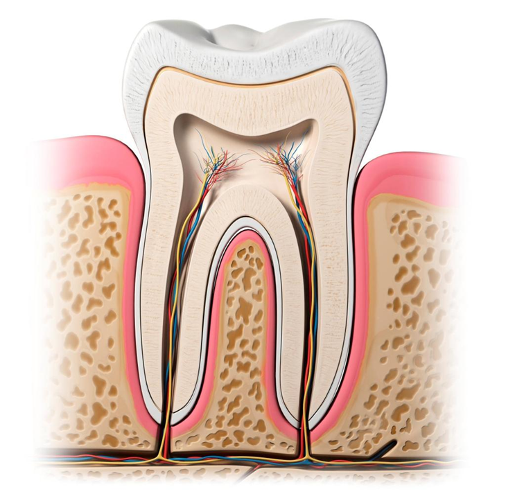

Source 1 https://bit.ly/2te8RqA Regular oral health care, like frequently flossing and brushing as well as a visit to the dentist at least twice a year, can preserve severe dental circumstances. But the statistic of the American Dental Association (ADA), showing that every year, [approximately a hundred million Americans](https://www.mouthhealthy.org/en/dental-care-concerns/questions-about-going-to-the-dentist) don’t visit the dentist. It is the most concerning issue. Persisting gum swelling and toothache can contribute to great issues if left unresolved or untreated. In addition, losing teeth, or bad dental health is connected with enlarged risk for conditions like heart disease. It would best for you if you understand that you don’t require any symptoms to visit your dentist. We all can keep our mouth as pain-free and healthy as possible before experiencing any symptoms. There are several spots that don’t heal, such as sores, ulcers, and tender parts in the mouth may specify numerous health conditions. All of them will not affect the gums as well as teeth. For instance, non-healing wounds in the mouth may sometimes specify diabetes. Diabetic patients will take more time and face difficulty in healing wounds than those people who don’t have diabetes.

Besides this, there some added symptoms, which include trouble moving jaw and tongue, jaw swelling, hoarseness, trouble swallowing or breathing and many more. If you are experiencing any kind of these following symptoms without wasting time, make an appointment with your dentist.

## **Swollen or Bleeding Gums**

Seeing the blood on the toothbrush or in the sink after brushing your teeth may be cause for concern. Because healthy gum tissue must not bleed unless you will be brushing too harshly or aggressively. The gingiva (gums) grip the teeth in place. Gingiva is responsible for making a barrier between the teeth nerves, blood vessels, and roots as well as the drink or food you ingest. Without having healthy gum tissues, there is a chance that a person could lose the teeth or a tooth.

Swollen or bleeding gums can specify gum disease or periodontal. That’s why it is suggested to visit your dentist, so they can examine your teeth and gum tissues as well as provide you guidance in case of any oral health problem.

## **Bad Breath **

Sometimes garlic-filled meals can be a cause of bad breaths or a clue that you have to drink much water. But long-lasting bad breath could be an indication of gum disease as well as gum cavities. Only your dentist can suggest an appropriate tip to maintain your bad breath even though if you don’t have any clues of dental decay.

## **Pain **

Any form of pain in the mouth can be a sign that the mouth is not as healthy as it supposed to be. If you are experiencing on and off the pain in your gums and teeth, then you must have to make an appointment to visit your dentist for a regular check-up. It will keep you protected from later on severe dental conditions.
