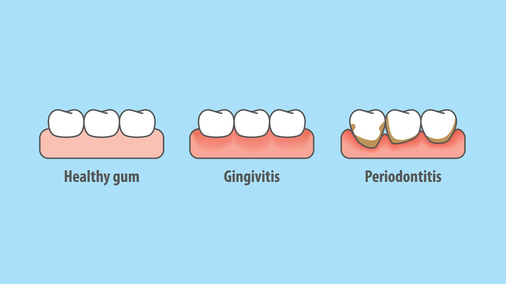

Due to periodontal diseases, people experience unhealthy gums or gums loss. This dental disease is led by a plaque buildup and tartar on the teeth. In case these issues become progressive, it can lead the gums to recede and the roots of the teeth to become exposed. To reverse your unhealthy gums into a healthy one, you’ll require a get dental care. You also need to make some conversions in your diet or oral routine that can enhance the health of the gums.

## **Signs that the Gums are Unhealthy **

In order to take proper care of the gums, it’s essential to look out for signs that indicate there is an issue developing. Signs that you might have an issue developing include:

- Red gums
- Uncontrollable bad breath
- Tender gums
- Bleeding gums
- Swollen gums
- Red gums
- Painful chewing
- Sensitive teeth
- Receding Gums

Here we have some effective tips and tricks in order to get back to your healthy gums.

## **Dental Cleanings **

A regular dental cleaning can greatly minimize the chance of gum loss. In dental cleaning, the dentist will clean away the tartar and plaque that can lead to periodontal disease.

- In the regular cleaning checkups, your dentist will possibly spot the signs of unhealthy gums or gums loss.
- In case you feel your gums are receding, you need to make an appointment to visit your dentist as soon as possible. The dentist can examine the state of the gums, clean the teeth, and guide you regarding the treatments that you may require.

## **Specialized Cleaning for Receding Gums **

This procedure is also known as root planning and tooth scaling, remove tartar and plaque from as well as below the gums. Making a clean and smooth surface under your gums will enable them to return to their proper place. After smoothing the surface area of your tooth, bacteria will have a tough time attaching to the surface of the tooth later.

## **Quit Smoking **

Smoking can lead to a large amount of plaque to attach to the teeth. It can also lead the gums to start receding. To eliminate the issues related to gums and teeth, make a plan in order to quit smoking and put the plan into action. There are many things that can lead the gums to recede that you can’t eliminate or prevent. However, you may be aware of the other contributing factors and know that you require to be especially vigilant about your dental care if you have them — for instance, old age, pregnancy, a family history of gum issues, and menopause.
