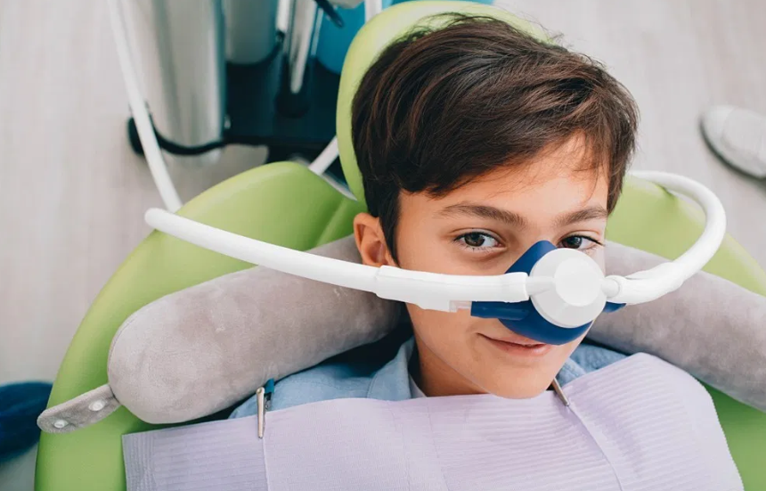

## **WHAT IS ANXIETY?**

Anxiety is a state of agitation or restlessness of the soul, this means that it is a psychic disturbance characterized by a state of extreme insecurity and restlessness. The main signs and symptoms of anxiety are sweating, tachycardia, blushing, piloerection, apprehension, fear, restlessness, shocks, tremors, among others. There is talk of pathological anxiety when responses far from being adaptive become a problem due to their exaggeration. Thus, anxiety can be exogenous primary, whether it is childhood phobias, or endogenous primary due to an anxiety crisis.  Stress can be one of the triggers of anxiety. Stress increases the heart and respiratory rate, and the release of catecholamines (before the possibility of aggression) that causes an increase in blood pressure and an increase in oxygen consumption at the muscular level. So the pain threshold decreases.

Stress and anxiety, related to the dental office visit, can trigger anginal attacks in the office. Therefore, staff must be prepared / trained for these situations. Stress causes:

- Tachycardia
- Tachypnea
- Increased blood pressure
- Increased muscle function
- Increased secretion of endogenous catecholamines.

Before an effort, the coronary patient increases his myocardial oxygen demands, just like the normal subject but, unlike this, loses the ability to increase the flow.

## **THE FORMS OF ANXIETY RELATED TO DENTISTRY**

Pain has a purpose: to warn that the environment represents a danger for the organism itself; in this way the individual reacts with a defense mechanism that, in the long run if repeated, ends up being a reflex. Thanks to this repetitive experience, and also, above all, to mechanisms of association, anxiety protects the organism by anticipating danger, first stimulating a state of alertness or an evasion reaction that precedes the defense or fight phase already declared. The anxious note more pain. In addition to this decrease in pain threshold there is also an increase in medication tolerance. That’s why the dentist has to know how to treat that anxiety.

## **PSYCHOLOGICAL STRATEGY OF THE DENTIST**

When the dentist-patient interaction is very good, we could risk saying that there are plenty of other pain control methods that are not purely local anesthesia. It is the dentist (not parents or relatives etc.) who has to play the role of “driver” and provide all the necessary and accurate information about what is going to happen and who verbally explains what has happened and why that pain has occurred. The participation of the patient is very important, for example, to tell him to raise his hand when it hurts (he becomes in control of the pain), to inform him exactly when the intervention will last, the steps that we will follow … Then, the patient when checking that the The intervention has come out as the dentist had said, he is gaining confidence.

## **MECHANISMS OF STRESS CONTROL **

In the office there should be a relaxing music with adequate coloration to provide patient relaxation and avoid anxious situations. In addition, at a higher age there is a high percentage of polymedicated patients, which increases the likelihood of drug interactions. There should be good pain control, being able to guarantee patient analgesia. All this can increase anxiety, anxiety is transformed into stress. So for the control of pain and to ensure the non-perception of pain by patients, good analgesia should be done.

A local anesthesia with vasoconstrictor is used for local analgesia. A slow injection with a continuous aspiration, avoiding making quarters of rotation so that if you are inside a glass, when you perform the aspiration you can collapse this glass and have a false negative aspiration, that is why, when making small turns it can be ensured that it is not inside a glass. The total dose of adrenaline should never exceed 0.2mg in a healthy adult or 0.04mg in a cardiac patient, that is, a maximum of 4 carpules of local anesthesia.

### **METHODS AND ATTITUDES TO TAKE TO REDUCE ANXIETY IN THE DENTIST**

In the attitudes that must be taken by the dentist, three parts are distinguished:

- Before treatment
- During treatment
- Anxiety at the dentist

Before treatment, the patient should be listened carefully to the patient. Find all possible causes of anxiety in the patient and thus be able to combat them. It is important to explain to the patient in a clear way the treatment plan, attending to it according to their intellectual level. The environment in the office should be a relaxing environment. Finally, treatments should be carried out progressively and always taking into account the use of anxiolytics when necessary.
