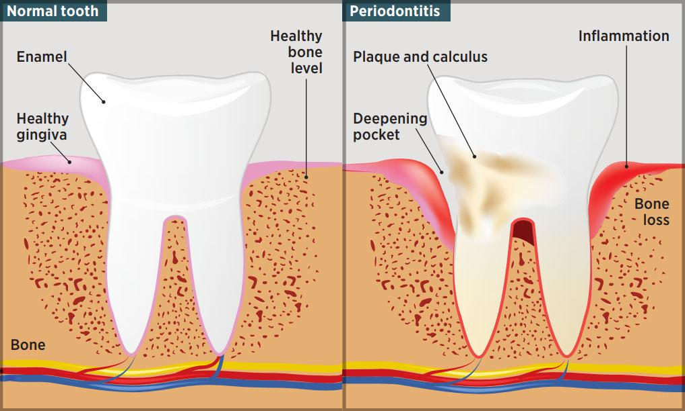
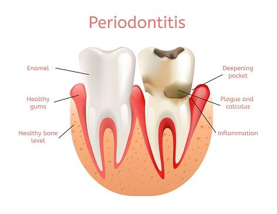

According to a study, approximately half of the Americans thirty years old or above, develop some kind of periodontal disease.

The symptoms can range from a slight illness along with a hollow pocket formation near the teeth to serious health issues including loss of bone and systemic inflammation. In case of severe health issues, it is always better to take notice earlier so that you can prevent developing any health-related complications such as bone loss or cardiovascular disease.

The culprit behind periodontal disease is oral plaque. It is a bacterial biofilm with a complicated structure, and it has a high defensive mechanism against antimicrobial agents. Plaques release inflammatory cytokines and enzymes from cells that are responsible for maintaining immunity and tend to break down periodontal ligament, a tissue that keeps teeth in their place.

To be more precise, periodontal disease has several stages.

## Stage 1: Healthy gums

This age is barely noticeable. The gingival sulcus, where the tooth meets the gum, is approximate 2mm. Bleeding and inflammation do not occur at this stage.

## Stage 2:  Gingivitis

Inflammation occurs with the building of plaque under gingival sulcus. The plaque releases toxins that affect the immune system and results in sore and swollen gums that bleed easily on contact. At this age, the gingival sulcus is about 3mm. Having bad breath and bad taste in the mouth is very usual.

## Stage 3: Mild Periodontal Disease

At this stage, the gap between gums and teeth gets larger and creates visible pockets. With a depth of 6mm, the gingival sulcus makes tooth cleaning extremely difficult. Calculus forming inside the pockets starts damaging the connective tissues that hold the teeth in their place.

There’s a higher risk of tooth loss at this stage. To prevent further damage, aggressive cleaning options are used, and to slow down the tissue loss, antibiotics like doxycycline are consumed.

## Stage 4: Advanced Periodontal Disease

The final stage holds significant damage such as tooth loss and bone loss. The pockets create more space between gums and the teeth. The damaged teeth might require removal and bone loss is compensated through surgical grafts.

Studies suggest that Periodontal disease is also linked to the development of heart disease. But, surprisingly, this disease is widespread around the world.
